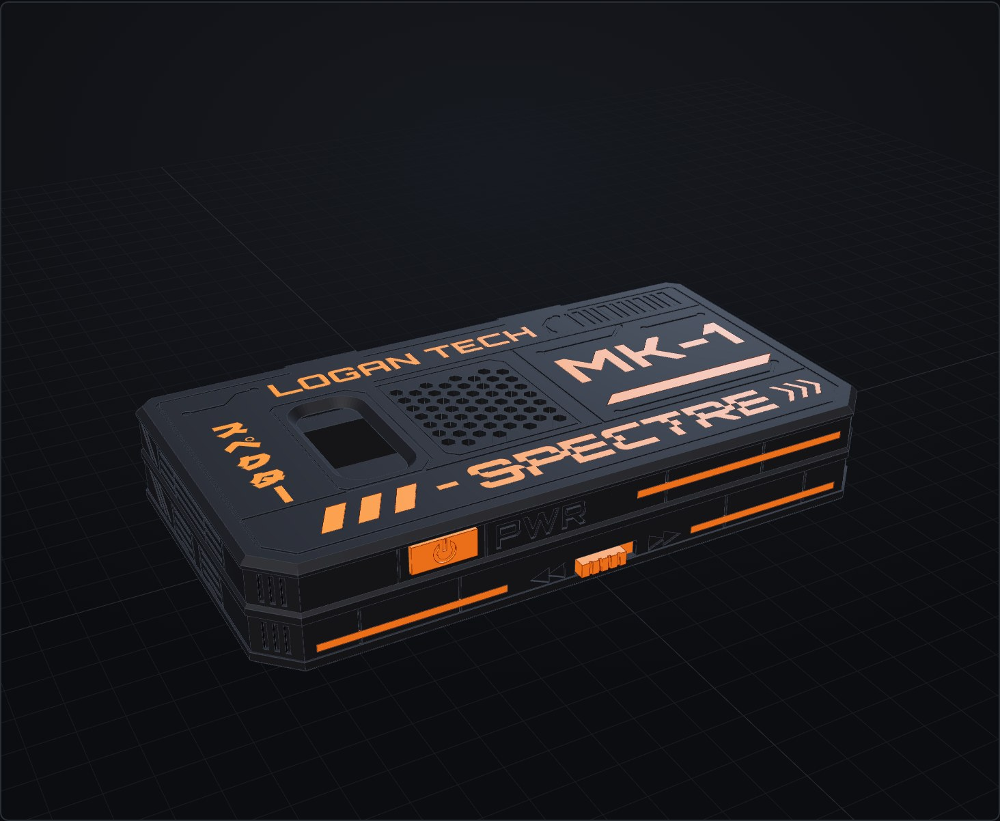
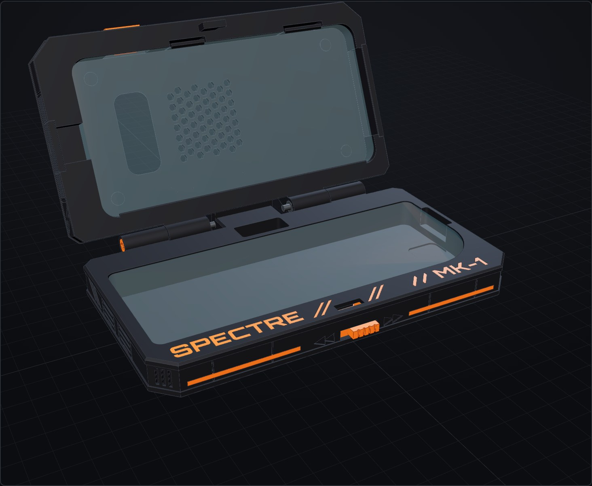
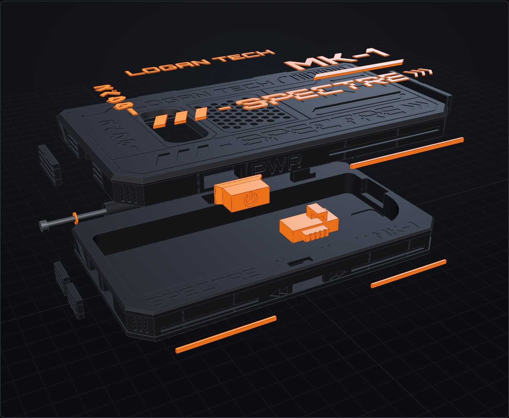
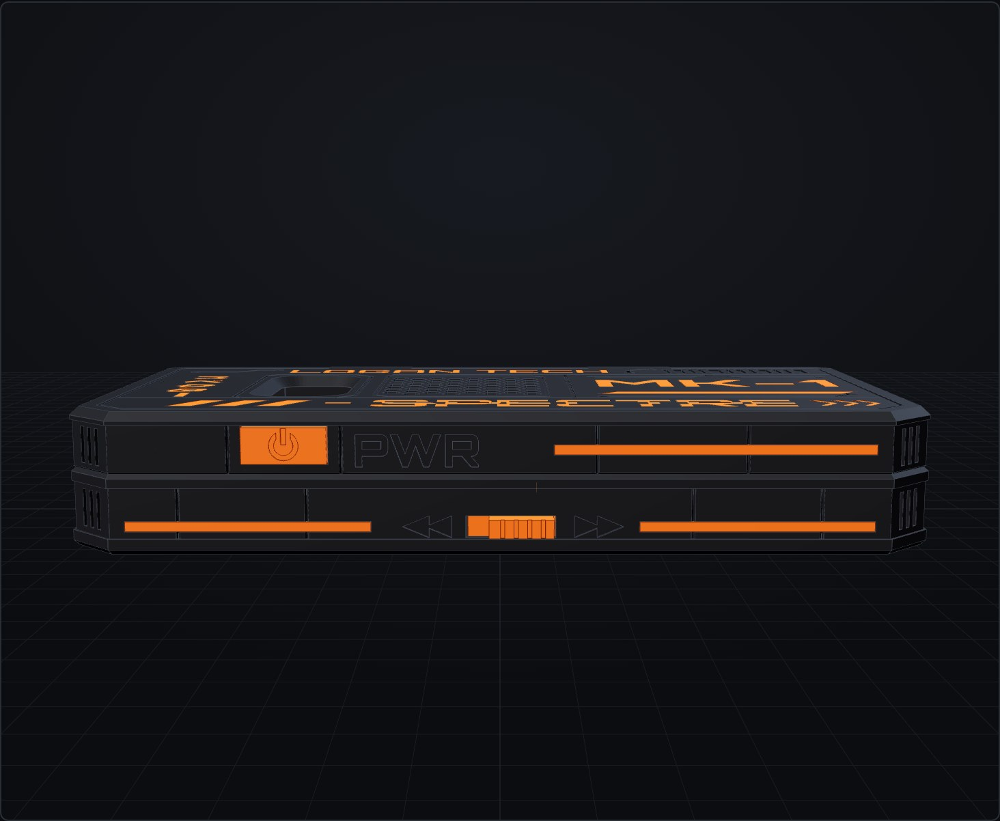

# MARK 1 SPECTRE

**A pocket-sized, 3D-printed cyberpunk cyberdeck.** A Samsung Galaxy S10e lives in the lid and a Rii Mini X1 keyboard in the base. It has a real hinge, a sliding lock, a Power button and optional orange AMS lettering.



| Open | Exploded view |
|---|---|
|  |  |

| Front (lock and Power) | Back (hinges) |
|---|---|
|  |  |

> 📦 **Just want to print it?** Grab the ready-to-print zip from the [latest release](../../releases/latest).
>
> 📱 **Want it for a different phone?** [Request it here](../../issues/new?template=new_phone.yml). The model is parametric, so with accurate measurements it can be adapted to other phones.

---

## Features

- **Phone:** Samsung Galaxy S10e (142.2 × 69.9 × 7.9 mm), no case.
- **Keyboard:** Rii Mini X1 / X1 Plus, with a floor slot for the bump on its back.
- **Closed size:** 164 × 89.2 × 26.8 mm. Opens to 115°, where a stop holds it.
- **Lock:** sliding lock with a ribbed finger tab and 4 mm travel.
- **Power button:** presses the phone's own key through the lid.
- **Caps:** disguised side caps over the ports and microphone.
- **Phone retention:** a fixed lip and 2 flexible snap tongues. No glue.
- **Printing:** everything prints flat with **no supports**, designed for a 0.4 mm nozzle.
- **Orange letters (optional):** AMS lettering that uses only 6 orange layers in total.

## What to print

Everything is in [`stl/`](stl) (or in the release zip), split into folders. Print the folders in number order.

| Folder | Contents | Colour |
|---|---|---|
| `1_TEST_fit` | **00a** phone and **00b** keyboard fit jigs: check the fits before spending filament | any |
| `2_TEST_mechanics_and_caps` | hinge (00d/00e), lock (00f/00g) and side-window (00c) tests, plus caps 05–07 | black |
| `3_parts` | lock 03, Power button 04, stripes 08, screw caps 09, neon bars 10 | orange |
| `4_TEST_AMS_letters` | AMS lettering test (optional) | black + orange |
| `5_BASE` | base **without** AMS, or **with** AMS (`01_..._AMS` + `11_..._ORANGE`) | black (+ orange) |
| `6_LID` | lid **without** AMS, or **with** AMS (`02_..._AMS` + `12_..._ORANGE`) | black (+ orange) |

**Settings** (tested on a Bambu Lab A1):
- **Material:** PETG or ASA. PLA softens in the sun and the snap tongues break.
- **Layers and infill:** 0.2 mm layers, 4 walls, 25–30 % infill.
- **Orientation:** import the files as they are. Don't rotate them and don't use auto-orient.
- **Supports:** **off**.
- **With AMS:** import the body and its letters together. When asked whether to load them as a single object with multiple parts, answer **Yes**. Then assign the letters to orange.

## Hardware

- **2 × M3×40 socket head screws** (DIN 912).
- **2 × M3 nuts:** nylon lock nuts, or plain nuts with mild threadlocker.

Don't use M3×35: the nut only engages halfway.

## Assembly

1. **Lock:** drop the orange lock into the keyboard pocket from the back. Its tab faces forward and the lock is pushed to the right (**OPEN ▶**). Push it forward until the tab comes out through the front window.
2. **Keyboard:** lower the Rii Mini X1 in flat, with its rounded corner on the right. The keyboard holds the lock down.
3. **Power button:** insert the orange button from inside the lid, flange facing in.
4. **Phone:** slide the volume-key side under the fixed lip first. Then press the other side down until the snap tongues click.
5. **Hinges:** join base and lid with the 2 screws. The head goes into the base and the nut sits in the hex pocket of the lid. Tighten until the lid holds any angle.
6. **Finishing:** fit the side caps, then glue the stripes 08, screw caps 09 and neon bars 10 into their slots.

**Lock:** with the tab to the **left (◀ LOCK)** the lid stays shut. Move it to the **right (OPEN ▶)** to open.

## Adapting to another phone or keyboard

The whole model is generated by [`src/mark1_spectre_v3.py`](src/mark1_spectre_v3.py) ([CadQuery](https://cadquery.readthedocs.io)). All the dimensions are in the parameter block at the top:

| Parameter | What it is |
|---|---|
| `PH_L, PH_W, PH_H` | phone length, width and thickness |
| `PH_CLR_L, PH_CLR_W, PH_PAD` | pocket clearances and floor pads |
| `PWR_FROM_TOP` | distance from the top of the phone to the centre of the Power key |
| `VOL_FROM_TOP` | clear zone for the volume keys (other side) |
| `CAM_CENTER_FROM_TOP, CAM_SIZE, CAM_R` | camera window |
| `KB_TRAY` (`kb_tray_pocket.json`) | keyboard pocket outline |
| `KB_BUMP` | slot for the bump on the back of the keyboard |

```bash
pip install cadquery shapely
cd src
python3 mark1_spectre_v3.py ../stl_new
```

For a new phone, print the generated **00a** jig first (about 10 g and 40 min) before printing the full lid.

## Requesting another phone

Open a [new phone request](../../issues/new?template=new_phone.yml) and include:
- the exact phone model;
- its dimensions (official, or measured with a ruler);
- where the camera and the keys are;
- whether you use a case;
- photos of the back and the sides.

The more accurate the measurements, the better the fit.

## License

- **Models and source:** [CC BY-NC-SA 4.0](LICENSE), © Logan Tech. You may print, modify and share them, as long as you give credit, don't sell them, and share your changes under the same license.
- **Fonts** in `src/fonts`: Orbitron and Dela Gothic One, both under the SIL Open Font License 1.1 (see the `OFL-*.txt` files).
