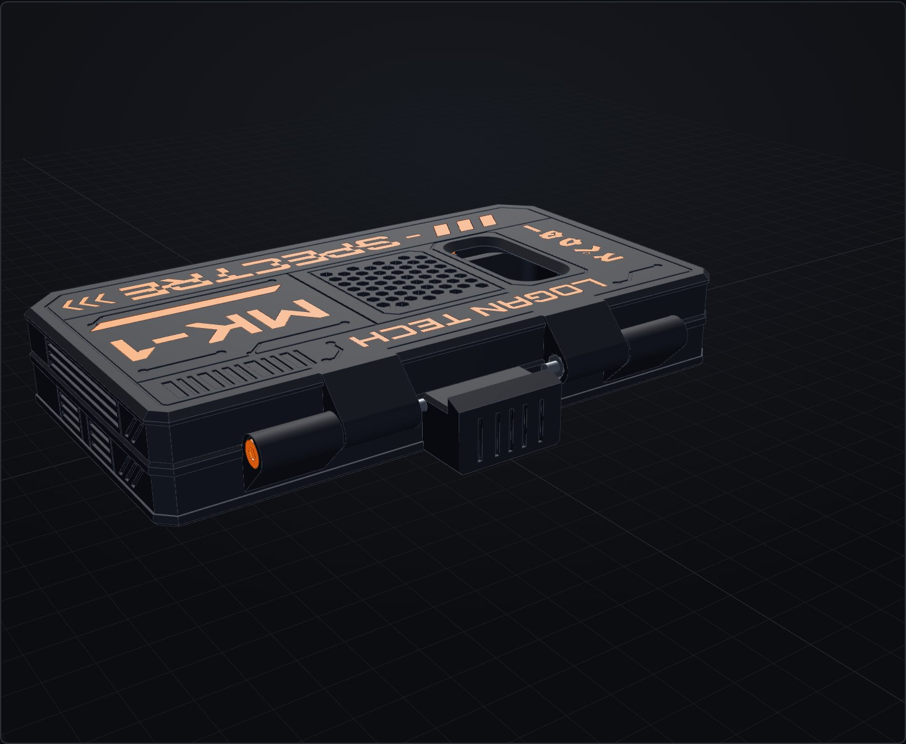

# MARK 1 SPECTRE

**Cyberdeck de bolso, estilo cyberpunk, impresso em 3D.** Um Galaxy S10e na tampa e um teclado Rii Mini X1 na base, com dobradiça, tranca deslizante, botão Power e letras laranja com AMS.

*Pocket cyberpunk cyberdeck, 3D printed: Galaxy S10e in the lid, Rii Mini X1 keyboard in the base. English summary at the bottom.*


| Aberto | Vista explodida |
|---|---|
|  |  |

| Frente (tranca e Power) | Trás (dobradiças) |
|---|---|
|  |  |

> 📱 **Queres para outro telemóvel?** [Pede aqui](../../issues/new?template=novo_telemovel.yml). O modelo é paramétrico: com as medidas certas adapta-se a outro telemóvel.

---

## Características

- **Telemóvel:** Samsung Galaxy S10e (142,2 × 69,9 × 7,9 mm), sem capa.
- **Teclado:** Rii Mini X1 / X1 Plus, com rasgo para a saliência de trás.
- **Fechado:** 164 × 89,2 × 26,8 mm. Abre até 115°, com batente.
- **Tranca deslizante:** patilha com estrias, curso de 4 mm.
- **Botão Power:** carrega na tecla do telemóvel com a tampa montada.
- **Tampas:** tampas laterais disfarçadas para portas e microfone.
- **Telemóvel no lugar:** preso por lábio fixo + 2 linguetas flexíveis, sem cola.
- **Impressão:** tudo plano, **sem suportes**, pensado para bico 0,4 mm.
- **Letras laranja (opcional):** com AMS, só 6 camadas de laranja no total.

## O que imprimir

Tudo está em [`stl/`](stl), por pastas. A ordem das pastas é a ordem de impressão.

| Pasta | O que é | Cor |
|---|---|---|
| `1_TESTE_encaixes` | **00a** telemóvel e **00b** teclado: confirma os encaixes antes de gastar filamento | qualquer |
| `2_TESTE_mecanica_e_tampas` | testes da dobradiça (00d/00e), da tranca (00f/00g), das janelas (00c) e as tampas 05–07 | preto |
| `3_pecas` | tranca 03, botão 04, faixas 08, tampas dos parafusos 09, barras néon 10 | laranja |
| `4_TESTE_AMS_letras` | teste das letras com AMS (opcional) | preto + laranja |
| `5_BASE` | base, **sem** AMS ou **com** AMS (`01_..._AMS` + `11_..._LARANJA`) | preto (+ laranja) |
| `6_TAMPA` | tampa, **sem** AMS ou **com** AMS (`02_..._AMS` + `12_..._LARANJA`) | preto (+ laranja) |

**Definições** (testado numa Bambu Lab A1):
- **Material:** PETG ou ASA. O PLA amolece ao sol e as linguetas partem.
- **Camadas e enchimento:** camada de 0,2 mm, 4 paredes, 25–30 % de enchimento.
- **Orientação:** importa os ficheiros tal como estão, sem rodar e sem "auto-orient".
- **Suportes:** **desligados**.
- **Com AMS:** importa o corpo e as letras juntos e, quando perguntar, responde **Sim** a "objeto com várias peças". Depois põe as letras no filamento laranja.

## Material extra

- **2 × parafusos M3×40** (DIN 912, cabeça cilíndrica) + **2 × porcas M3**. A porca pode ser autoblocante, ou normal com Loctite fraco. Não uses M3×35: a porca fica só meio enroscada.

## Montagem

1. **Tranca:** pousa a tranca laranja no encaixe do teclado, por trás, com a patilha virada para a frente e encostada à direita (**OPEN ▶**). Empurra-a até a patilha sair pela janela da frente.
2. **Teclado:** encaixa o Rii Mini X1 na horizontal, com o canto redondo para a direita. O teclado prende a tranca por cima.
3. **Botão Power:** mete o botão laranja por dentro da tampa, com o flange para dentro.
4. **Telemóvel:** mete primeiro o lado do volume por baixo do lábio fixo e depois carrega no outro lado até as linguetas fazerem clique.
5. **Dobradiças:** junta a base e a tampa com os 2 parafusos. A cabeça entra na base e a porca fica no sextavado da tampa. Aperta até a tampa ficar parada em qualquer ângulo.
6. **Acabamento:** encaixa as tampas laterais e cola as faixas 08, as tampas 09 e as barras néon 10 nos rasgos.

**Tranca:** com a patilha para a **esquerda ◀ LOCK** a tampa fica presa. Para a **direita OPEN ▶** abre.

## Adaptar a outro telemóvel ou teclado

O modelo é gerado pelo script [`src/mark1_spectre_v3.py`](src/mark1_spectre_v3.py) ([CadQuery](https://cadquery.readthedocs.io)). Todas as medidas estão no bloco de parâmetros no topo:

| Parâmetro | O que é |
|---|---|
| `PH_L, PH_W, PH_H` | comprimento, largura e espessura do telemóvel |
| `PH_CLR_L, PH_CLR_W, PH_PAD` | folgas do encaixe e pastilhas do fundo |
| `PWR_FROM_TOP` | distância do topo do telemóvel ao centro do botão Power |
| `VOL_FROM_TOP` | zona livre para o volume (lado oposto) |
| `CAM_CENTER_FROM_TOP, CAM_SIZE, CAM_R` | janela da câmara |
| `KB_TRAY` (`kb_tray_pocket.json`) | contorno do recorte do teclado |
| `KB_BUMP` | rasgo para a saliência de trás do teclado |

```bash
pip install cadquery shapely
cd src
python3 mark1_spectre_v3.py ../stl_novos
```

Para outro telemóvel, imprime primeiro o teste **00a** gerado (10 g, ~40 min) antes da tampa completa.

## Pedir outro telemóvel

Abre um [pedido de novo telemóvel](../../issues/new?template=novo_telemovel.yml) com:
- o modelo exato do telemóvel;
- as medidas (oficiais ou medidas com régua);
- a posição da câmara e dos botões;
- se usas capa ou não;
- fotos das costas e dos lados.

Quanto mais exatas as medidas, melhor fica o encaixe.

## Licença

- **Modelos e script:** [CC BY-NC-SA 4.0](LICENSE), © Logan Tech. Podes imprimir, modificar e partilhar, desde que dês crédito, não vendas, e partilhes as alterações com a mesma licença.
- **Fontes** em `src/fonts`: Orbitron e Dela Gothic One, ambas com licença SIL Open Font License 1.1 (ver os ficheiros `OFL-*.txt`).

---

### English summary

Pocket cyberpunk cyberdeck for a **Samsung Galaxy S10e** (lid) and a **Rii Mini X1** keyboard (base).
- **Mechanics:** hinge with a 115° stop, sliding lock, power button that presses the phone key, snap-fit phone retention.
- **Printing:** no supports, designed for a 0.4 mm nozzle; optional orange AMS lettering (6 orange layers only).
- **Files:** STLs in `stl/` (print folders 1→6 in order), STEP in `step/`, parametric CadQuery source in `src/`.
- **Hardware:** 2 × M3×40 + 2 × M3 nuts.
- **Other phones:** [open a phone request](../../issues/new?template=novo_telemovel.yml) with your phone's dimensions.

License: CC BY-NC-SA 4.0.
